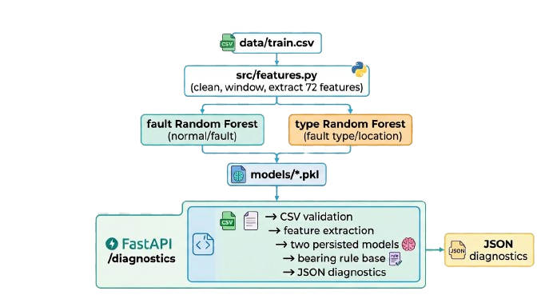

<p align="center">

</p>
<h1>Intelligent Knowledge-Based System for Industrial Equipment Fault Diagnosis and Maintenance Decision Support</h1>

<p align="center">
    
</p>

## 1. Problem Description / Project Context

Industrial rotating equipment depends on bearings operating within acceptable
vibration, loading, lubrication, alignment, and temperature limits. A bearing
defect can begin as a small change in vibration and develop into spalling,
rolling-element damage, or a loss of fit. The system in this project is
intended for condition-based maintenance of such equipment. It receives
time-domain acceleration measurements from the drive end (`DE_Time`) and
fan end (`FE_Time`), grouped by `RecordingID`, and uses those measurements to
determine whether a bearing fault is present and, when possible, whether it is
associated with the inner race, rolling element (ball), or outer race. The
training data also records the measurement location (`Defect_From`) and
operating speed (`RPM`), although the current feature pipeline uses the two
vibration columns and does not use `RPM` as a model feature.

In practice, evidence is heterogeneous: sensor time series, recording
metadata, model predictions, maintenance history, manufacturer guidance, and
technician observations may not agree or may be incomplete. Several physical
causes can produce similar symptoms, and different stakeholders have
different priorities. Operations may prefer continued production, maintenance
may prefer an early inspection, and safety/reliability personnel may require a
conservative intervention. This project addresses the diagnosis and
maintenance-recommendation part of that problem. A machine-learning front end
classifies vibration windows, while a transparent bearing knowledge base maps
the classification to possible causes, severity, and recommended checks. The
system deliberately returns review instructions when its two predictions
conflict or when a component-specific conclusion cannot be justified.

## 2. Problem Analysis

### 2.1 Problem Understanding

The implemented task has two related decisions:

1. **Fault detection:** decide whether a processed vibration window represents
   normal operation (`0`) or a bearing fault (`1`).
2. **Fault-type classification:** classify the window as `Normal`, `Ball`,
   `Inner Race`, or `Outer Race`, with the training labels retaining
   `Drive-End` or `Fan-End` in parentheses.

The input is a CSV containing at least `DE_Time`, `FE_Time`, and
`RecordingID`. The API requires at least 2,048 data rows because the smallest
analysis window is 2,048 samples. Each recording is processed independently
using overlapping windows of 2,048 samples and a step of 1,024 samples.
Predictions are returned per recording and per window, together with a
maintenance action from the rule base.

The repository contains 7,415,812 training rows across 52 recordings and
2,313,875 test rows across 18 recordings. The training fault labels are
0 (normal), 1 (inner race), 2 (ball), and 3 (outer race). These observations
show that the project is a bearing-vibration diagnostic prototype rather than
a general-purpose plant-wide asset management system.

### 2.2 Stakeholders and Their Requirements

| Stakeholder | Requirement addressed by the system |
|---|---|
| Maintenance technicians | Receive a likely fault location, possible physical causes, and inspection actions. |
| Reliability engineers | Use repeatable vibration features and consistent fault labels to prioritize investigation. |
| Operations | Distinguish a normal result from a result requiring prompt review, while avoiding an unjustified shutdown instruction. |
| Safety and asset owners | Get conservative handling of unknown and conflicting predictions and an auditable reason for the recommendation. |
| Data/ML engineers | Train, persist, and evaluate separate fault and type classifiers using a reproducible feature pipeline. |
| API or application integrators | Upload a CSV and receive structured JSON diagnostics, with explicit HTTP errors for invalid input. |

The code directly supports technicians, engineers, and integrators. Stakeholder
priorities such as production continuity versus early intervention are treated
as design constraints; the repository does not implement a workflow, approval,
role-based access control, or automatic shutdown.

### 2.3 Constraints and Conflicting Requirements

The main constraints are:

- The source data is a two-channel time series, not a complete digital-twin
  representation of the machine.
- Every complete window must contain 2,048 samples, and windows overlap by
  1,024 samples.
- The feature extractor assumes a sampling frequency of 12,000 Hz and applies
  a fourth-order 2,000 Hz high-pass Butterworth filter for envelope analysis.
- The API requires CSV input and the columns `DE_Time`, `FE_Time`, and
  `RecordingID`; malformed files, missing columns, and too-short files are
  rejected.
- The persisted models are Python pickle files and must be available in the
  repository's `models` directory.
- The models provide class predictions but the API does not expose calibrated
  probabilities or confidence scores.
- `RPM` is present in the dataset but is not used in the current 72-feature
  vector, so changes in speed or load are not explicitly modelled.

There are two important conflicts. First, operations may want to continue
running while maintenance wants to inspect a suspected defect. The knowledge
base therefore recommends continued operation only for a normal result, and
uses inspection/review language for fault results rather than issuing an
automatic stop command. Second, the binary fault model and the type model can
disagree. The rule layer gives precedence to the disagreement state and
requests review instead of silently selecting a component-specific action.

### 2.4 Root Cause / Requirement Identification

The engineering root cause addressed by the system is the difficulty of
turning high-volume vibration samples into an actionable, explainable
maintenance decision. Raw samples are not directly suitable for the
classifier, and a class label alone does not tell a technician what to
inspect. The implementation therefore separates:

1. signal conditioning and feature extraction in `src/features.py`;
2. statistical classification in the persisted Random Forest models; and
3. domain reasoning and maintenance actions in
   `knowledge_base/bearing_faults.py`.

The resulting requirements are to detect a fault, identify its likely bearing
part and measurement location when possible, preserve uncertainty, explain
likely causes, and provide concrete verification actions. The design also
requires deterministic handling of invalid model combinations, rather than a
success-shaped response for every input.

### 2.5 Assumptions

- `DE_Time` and `FE_Time` are comparable vibration/acceleration channels
  sampled at 12 kHz.
- Rows belonging to one `RecordingID` are ordered samples from one recording;
  grouping does not reorder samples.
- A recording-level mode is a suitable label for its windows during training.
- A normal model type means no bearing fault, while a non-normal type with a
  normal fault flag is inconsistent.
- The model's predicted class is evidence for prioritization, not proof of a
  physical failure. Physical inspection is required before corrective work.
- The maintenance actions are generic bearing guidance and must be reconciled
  with manufacturer limits, site procedures, current load, temperature, and
  safety controls.
- Missing `Defect_From` values in labelled data can be represented as
  `Normal`, as implemented by the preprocessing code. This is a data
  preparation convention, not a physical conclusion.

## 3. Knowledge Representation and KBS Design

### 3.1 Selected Knowledge Representation Formalism

The project uses a **hybrid representation**:

1. **Numerical feature vectors** represent the measurable vibration signal.
   Each channel contributes four statistical features, 16 normalized
   time-spectrum band energies, and 16 normalized envelope-spectrum band
   energies. Two channels therefore produce 72 features per window.
2. **Supervised model knowledge** is encoded in two Random Forest classifiers,
   each containing 300 estimators with balanced class weighting.
3. **Production rules and frames** are encoded as a Python dictionary in
   `BEARING_KBS`. Each frame contains a status, severity, component (where
   applicable), possible causes, and actions.

This combination is appropriate because the signal-to-class mapping benefits
from learned nonlinear boundaries, while the maintenance recommendation must
remain readable and editable by domain specialists. It is not a formal OWL
ontology or a probabilistic graphical model.

The feature construction for one channel is:

```text
channel = [
    skewness, kurtosis, peak/RMS, peak/mean-absolute-value,
    16 normalized FFT-power bands,
    16 normalized envelope-spectrum-power bands
]
DE_Time channel + FE_Time channel = 36 + 36 = 72 features
```

### 3.2 Knowledge Base / Ontology / Rule Base

The learned label vocabulary is:

| Model output | Meaning | Knowledge-base frame |
|---|---|---|
| `Normal` | No bearing fault detected | `Normal` |
| `Ball (Drive-End)` / `Ball (Fan-End)` | Rolling-element fault | `Ball` |
| `Inner Race (Drive-End)` / `Inner Race (Fan-End)` | Inner-race fault | `Inner Race` |
| `Outer Race (Drive-End)` / `Outer Race (Fan-End)` | Outer-race fault | `Outer Race` |

The type label's location suffix is retained for diagnosis output but is
removed before selecting the generic component rule. For example,
`Inner Race (Drive-End)` selects the `Inner Race` frame. The frames include:

- **Normal:** low severity, routine operation if other indicators are normal,
  continued monitoring, and preventive maintenance.
- **Inner Race:** high severity; possible fatigue/spalling, lubrication,
  misalignment/loading, or incorrect fit/mounting.
- **Ball:** high severity; possible rolling-element damage, contamination,
  lubrication, mounting/impact, or cage damage.
- **Outer Race:** high severity; possible raceway damage, housing fit or
  distortion, misalignment, or uneven loading.
- **Unknown fault:** high severity but no component-specific cause; repeat the
  measurement and investigate signal quality and operating conditions.
- **Conflicting prediction:** review severity; reconcile model outputs before
  issuing a component-specific instruction.
- **Invalid input/prediction:** review and verify the model-output mapping.

The principal rule table is:

| Condition | Result |
|---|---|
| `fault == 0` and type is `Normal` | Normal frame |
| `fault == 0` and type is non-normal/known | Prediction conflict |
| `fault == 1` and type is `Normal` | Unknown fault |
| `fault == 1` and type is a known component | Component frame |
| Any other fault flag | Invalid prediction |

### 3.3 Inference Mechanism

Inference is a staged pipeline:

```text
CSV upload
  -> validate extension, columns, row count, and parseability
  -> drop rows missing DE_Time or FE_Time
  -> group samples by RecordingID
  -> create 2048-sample windows with 1024-sample stride
  -> extract 72 features per window
  -> fault_model.predict(features)
  -> type_model.predict(features)
  -> normalize type label and apply rule base
  -> return structured diagnostics
```

Training uses `load_and_process` to create the same feature representation.
The fault model is trained from whether the recording label is `Normal`, and
the type model is trained from the complete type/location label. The test
script reports a classification report and confusion matrix for both models.

At serving time, the FastAPI application loads `fault_model.pkl` and
`type_model.pkl` once at startup. Each result contains the recording ID,
zero-based window number, integer fault prediction, type prediction, and
maintenance action. The API does not perform a second probabilistic
inference, temporal smoothing, or aggregation across windows.

### 3.4 Conflict Resolution Strategy

Conflict resolution is explicit and conservative:

1. The type prediction is normalized against an allow-list of known labels.
   Unknown labels become `Unknown`.
2. A normal fault flag paired with a non-normal type is treated as a
   **Prediction Conflict**, not as a fault.
3. A fault flag paired with `Normal` is treated as **Fault Detected - Type
   Uncertain**, and the generic unknown-fault instructions are returned.
4. A fault flag with a recognized component selects the matching rule.
5. Unsupported fault values produce **Invalid Prediction** and request output
   verification.

This ordering prevents the system from converting contradictory outputs into a
confident maintenance instruction. The conflict action requests checking model
outputs, label mapping, and repeating the measurement. Although the rule text
mentions confidence scores, the current API does not calculate or return
confidence scores; that is an identified future enhancement rather than an
implemented capability.

### 3.5 Explanation Facility

The explanation facility is rule-based and action-oriented. For normal and
component-specific results, the response exposes the selected status,
severity, component, possible causes, and recommended inspection or
maintenance actions. The action text connects a model conclusion to
observable checks, such as lubricant condition, shaft alignment, housing fit,
seals, loading, temperature, raceways, rolling elements, and cage condition.

For uncertainty, the response explains what was not established: an unknown
fault must be investigated, while a conflict must be reconciled before a
component-specific instruction is issued. This is a useful distinction
between a diagnosis hypothesis and a verified physical root cause.

The current explanation does not expose the individual feature values, Random
Forest tree votes, feature importance, probability calibration, or the exact
training recording that led to a prediction. Those would be appropriate
extensions for stronger traceability.

### 3.6 System Architecture



Repository responsibilities:

| Area | Responsibility |
|---|---|
| `src/features.py` | Signal preprocessing, filtering, spectral/envelope features, and windowing. |
| `src/train.py` | Train and serialize the two Random Forest models. |
| `src/test.py` | Evaluate persisted models with reports and confusion matrices. |
| `knowledge_base/bearing_faults.py` | Normalize predictions, resolve conflicts, and generate maintenance actions. |
| `api/index.py` | FastAPI startup/model loading, request validation, prediction orchestration, and response formatting. |
| `data/` | Labelled training and test CSV data. |
| `models/` | Persisted classifier artifacts consumed by the API. |

The primary endpoint is `POST /diagnostics` with a multipart CSV upload.
`GET /health` returns `{"status": "ok"}`. The API removes its temporary upload
file after processing and returns explicit client errors for invalid CSV
content, missing required columns, insufficient rows, and empty complete
windows. Model prediction failures are returned as server errors rather than
being silently converted into a diagnosis.
